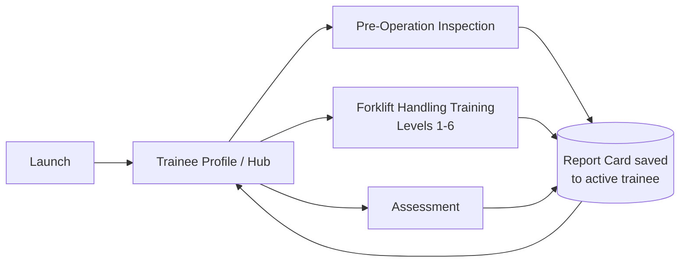

# CLAUDE.md — VR-ConTrain

> Project brief and working rules for Claude Code.
> Place this file in the **root of the Unity project** (next to `Assets/`, `Packages/`, `ProjectSettings/`). Claude Code loads it automatically at the start of every session.

---

## 1. Project at a glance

| Item | Detail |
|---|---|
| Name | **VR-ConTrain** — Immersive VR Training for Safe Vehicle Operations in the Workplace |
| What it is | Standalone VR simulator that trains new workers to operate a **forklift** safely before touching a real one |
| Platform | Meta Quest 3, **standalone** (Android build, no PC required at runtime) |
| Engine / language | Unity 6.x LTS, C#, Universal Render Pipeline (URP) |
| XR stack | OpenXR (Meta Quest support) + XR Interaction Toolkit (XRI) + new Input System |
| Developer | Noy (Radin Izz Zuhair), University of Malaya — Final Year Project, **FYP2 = development phase** (requirements & design completed in FYP1) |
| Methodology | Hybrid Agile–Waterfall: design is fixed; build in short sprints with a working build at the end of each |
| Scope | **4 modules only** (§2). Noy will announce future modules — do not build ahead of them. |

---

## 2. Scope

### 2.1 In scope (v1)

| # | Module | Purpose | Output |
|---|---|---|---|
| 1 | **Trainee Profile** | Entry hub: create/select trainee, view profile, history, scores and results | Profile page, history list, report card viewer |
| 2 | **Pre-Operation Inspection** | Walk around and check the forklift before driving; find defects | Inspection result → shown on checkboard blender model |
| 3 | **Forklift Handling Training** | Multiple levels teaching how to handle the forklift (driving, steering, mast/fork levers, loads) | Per-level result, sequential level unlock |
| 4 | **Assessment** | Timed scenario: complete given tasks within a time limit; scored | **Performance Report Card** |

### 2.2 Out of scope (unless Noy says otherwise)

- Other vehicles (excavator, crane, etc.)
- Multiplayer, cloud sync, online accounts, instructor web dashboard
- Hand tracking as primary input (controllers are primary)
- Voice commands, multi-language UI

### 2.3 Core flow



- One active trainee per session; every result is saved against that trainee.
- Suggested learning path: Inspection → Training → Assessment (the hub allows free navigation except for locked items).

---

## 3. Module specifications

### 3.1 Module 1 — Trainee Profile (Hub)

**Setting:** site office / locker room. Trainee stands; world-space UI panels.

| Feature | Detail |
|---|---|
| Create profile | Display name + trainee/staff ID (optional). Text entry via world-space virtual keyboard |
| Select profile | Scrollable list of existing trainees |
| Profile page | Name, ID, created date, last active, training progress (levels passed / total), best assessment score, current status (Not assessed / Passed / Failed) |
| History | All report cards for the trainee, newest first: date, module, level/scenario, score, pass/fail, duration |
| Report card detail | Full breakdown: tasks, violations, inspection accuracy, time (§4) |
| Module launcher | Inspection, Training (level select showing locked/unlocked/passed), Assessment |
| Settings | Comfort (vignette on/off, snap vs smooth turn, turn angle), seated/standing, recenter, dominant hand, audio volume |
| Delete profile | With confirmation dialog; deletes the trainee's report cards too |

Rules:
- `SessionManager.CurrentTrainee` must be set before any module can start.
- Training progress is **derived from report cards** (passed level IDs) — no separate progress table (see §5 constraint).

---

### 3.2 Module 2 — Pre-Operation Inspection

**Setting:** forklift parked in a depot/yard. Trainee on foot (teleport + snap turn; continuous move optional).

**Flow**
1. Briefing panel: objective + how to inspect/mark items.
2. Trainee holds a checklist (clipboard/tablet attached to the off-hand).
3. For each item: find the component (highlights on hover) → inspect → mark **OK** or **Defect**.
4. Some items need an action: press horn, switch on lights, pull dipstick, press brake pedal, latch seatbelt, check gauge.
5. Submit → results screen (correct, missed defects, false alarms, time) → report card saved.

**Default checklist** (starting point for an IC/LPG counterbalance forklift — Noy to confirm against the reference used in the FYP1 report; an electric forklift swaps fluids/fuel for battery checks)

| Category | Item | Example defect to simulate |
|---|---|---|
| Visual | Tyres / wheels | Cut or worn tyre, missing wheel nut |
| Visual | Forks | Crack, bent tine, uneven fork tips |
| Visual | Mast & lift chains | Slack/rusted chain, damaged link |
| Visual | Hydraulic hoses & cylinders | Leak, fluid puddle under forklift |
| Visual | Overhead guard | Bent or damaged |
| Visual | Load backrest | Bent or missing |
| Visual | Data / capacity plate | Missing or unreadable |
| Visual | Fluid levels (engine oil, hydraulic, coolant) | Below minimum mark |
| Visual | Fuel / LPG cylinder (or battery) | Low fuel, loose LPG connection (or low charge, loose connector) |
| Visual | Seat & seatbelt | Torn belt, latch not locking |
| Operational | Horn | No sound |
| Operational | Lights / warning beacon | Not working |
| Operational | Reverse alarm | Not working |
| Operational | Service brake | Pedal sinks / weak |
| Operational | Parking brake | Does not hold |
| Operational | Steering | Excessive play |
| Operational | Lift / lower / tilt controls | Jerky or not responding |
| Operational | Instrument panel | Warning light on |

**Defect generation**
- `InspectionScenarioDefinition` (ScriptableObject) picks N defects from the pool — random seed for practice, fixed set for assessment.
- Every `InspectableComponent` has an OK state and one or more Defect states (swap mesh/material/decal/particle/audio).

**Scoring (defaults, configurable)**
- Correct mark: +1 · Missed defect: −2 · False alarm: −1
- Missing a **safety-critical** defect (brakes, steering, forks, hydraulics) → fail flag
- Hints toggle: when on, the next unchecked item is highlighted and an explanation shows after marking

---

### 3.3 Module 3 — Forklift Handling Training

**Setting:** training yard with lanes, cones, pallets, racks, signs, pedestrian walkways.
**Seating:** trainee sits in the cab; XR Origin is parented to a seat anchor and recentered when entering.

Each level is a `TrainingLevelDefinition` ScriptableObject. Proposed levels (count and content to be confirmed by Noy):

| Lvl | Title | Teaches | Default pass criteria |
|---|---|---|---|
| 1 | Cab familiarisation | Seatbelt, ignition, direction lever (F/N/R), accelerator, brake, horn, parking brake | Complete each control prompt in order |
| 2 | Moving straight | Forward and reverse along a lane, smooth stop at markers | Stop inside marker zone; ≤ 2 lane-edge contacts |
| 3 | Steering & manoeuvring | Rear-wheel steering, tail swing, cornering, slalom / figure-8 | Finish course; ≤ 2 cone hits |
| 4 | Mast & fork controls | Lift/lower, tilt forward/back (side-shift if modelled) | Reach target heights/angles within tolerance |
| 5 | Load handling | Approach pallet square, insert forks fully, lift slightly, tilt back, travel with load low, set down at target | Load placed inside zone; not dropped |
| 6 | Racking & workplace safety | Stack on rack levels, pedestrian zones, horn at intersections, speed limit, reversing when view is blocked, correct parking (forks down, neutral, parking brake, key off) | Complete with 0 critical violations |

**Per-level loop:** intro panel → guided step prompts (text, optional voice-over, highlight on the relevant control) → objective tracking → summary screen → report card saved.
**Progression:** level N+1 unlocks when level N is passed. Retry and "Return to Hub" always available.
Safety violations (§3.4) are also monitored in training, shown as instant feedback.

---

### 3.4 Module 4 — Assessment

**Setting:** realistic workplace (warehouse / construction yard).

| Aspect | Detail |
|---|---|
| Time limit | Default 10 min (per-scenario setting); timer visible on cab display |
| Tasks | Ordered list, e.g. fasten seatbelt & start → drive to Bay A → pick up pallet → follow marked route → place on rack level 2 → return and park correctly |
| Guidance | Task list + timer only; **no** step-by-step hints |
| Monitoring | `ViolationMonitor` runs for the whole attempt |
| End conditions | All tasks done · time runs out · critical violation (auto-fail, configurable) |
| Output | Performance Report Card → shown immediately → saved → viewable from Profile |
| Unlock | Default: unlocked after all training levels passed; a "demo mode" settings toggle unlocks everything (for presentations) |

**Scoring defaults** (placeholders in a `ScoringRules` ScriptableObject — final values decided with supervisor)

| Component | Points |
|---|---|
| Task completion | 60 (split across tasks) |
| Time | 10 (full if under target time, scaled to 0 at the limit) |
| Safety | 30, minus deductions below (floor 0) |

| Violation | Deduction |
|---|---|
| Collision with structure / rack / cone | −3 each |
| Load dropped | −10 |
| Overspeed | −2 per event |
| Travelling with forks raised above safe height | −3 per event |
| No horn at marked intersection / blind corner | −2 each |
| Seatbelt not fastened before moving | −5 (once) |
| Harsh braking or sharp turn with load | −2 each |
| Improper parking | −5 |
| **Critical:** hitting a pedestrian, tip-over | Auto-fail |

**Pass:** total ≥ 70 **and** no critical violation. Bands: ≥ 85 Excellent · 70–84 Competent · < 70 Needs Improvement.

---

## 4. Performance Report Card

Built automatically by `ReportCardBuilder` at the end of every inspection, training level and assessment.

| Field | Notes |
|---|---|
| ReportId, TraineeId | GUIDs |
| ModuleType | Inspection / Training / Assessment |
| ContentId | Level or scenario ID |
| StartedAt, CompletedAt, DurationSec | |
| Score, MaxScore, Passed, Band | |
| Tasks | Name, completed (y/n), time taken |
| Violations | Type, count, deduction, timestamp(s) |
| Inspection items | Item, actual state, trainee's mark, correct (y/n) |
| Auto remarks | Generated summary, e.g. "Most frequent issue: overspeed (4×). Practise Level 6." |

---

## 5. Data & persistence

**Constraint (from design):** the database is used **only** for the **Trainee Profile** and the **Performance Report Card**. All content — checklists, levels, tasks, scoring weights, violation rules — lives in ScriptableObjects, not the database.

- Local, on-device storage under `Application.persistentDataPath`. No network.
- All access goes through `IDataService` so the backend can be swapped.
- Backend: **SQLite** (e.g. sqlite-net) as target; `JsonDataService` is acceptable as the first implementation to unblock development. If SQLite is used, verify the Android arm64 native library on the Quest early.

| Table | Columns |
|---|---|
| `Trainee` | TraineeId (PK), DisplayName, StaffId, CreatedAt, LastActiveAt |
| `ReportCard` | ReportId (PK), TraineeId (FK), ModuleType, ContentId, StartedAt, CompletedAt, DurationSec, Score, MaxScore, Passed, Band, DetailJson |

`DetailJson` = serialized `ReportDetail` (tasks[], violations[], inspectionItems[], remarks).

---

## 6. Architecture

### 6.1 Scenes

| Scene | Contents |
|---|---|
| `00_Bootstrap` | Persistent: XR Origin rig, `SessionManager`, `IDataService`, `SceneLoader`, `AudioManager`, event channels |
| `10_Hub` | Trainee Profile UI, module launcher, settings |
| `20_Inspection` | Inspection depot + inspectable forklift |
| `30_TrainingYard` | One scene; active level configured from `TrainingLevelDefinition` (spawn point, props, objectives) |
| `40_Assessment_<Name>` | One scene per assessment scenario |

- Bootstrap stays loaded; content scenes load **additively** with a fade.
- Each content scene has a `PlayerSpawnPoint` (on-foot) and/or a forklift seat anchor.

### 6.2 Key systems

| System | Responsibility | Namespace |
|---|---|---|
| `SessionManager` | Active trainee, start/end module session, holds `SessionRecord` | Core |
| `SceneLoader` | Additive load/unload, fade, spawn placement | Core |
| `IDataService` (+ `SqliteDataService`, `JsonDataService`) | CRUD for Trainee & ReportCard | Data |
| Event channels (ScriptableObject) | `OnTaskCompleted`, `OnViolation`, `OnSessionEnded`, etc. | Core |
| `ForkliftController` | Drive physics: WheelColliders, front drive, **rear-wheel steering**, speed cap | Forklift |
| `MastController` | Lift/lower, tilt, (side-shift); clamped stages | Forklift |
| `ForkliftInputRouter` + `IForkliftInputSource` | Reads from `XRCabInput` (physical cab controls), `ControllerButtonInput` (fallback), `KeyboardDebugInput` (editor) | Forklift |
| `ForkliftTelemetry` | Single source of truth: speed, direction, fork height, tilt, load state, seatbelt, ignition, parking brake | Forklift |
| `LoadAttachment` | Pallet pickup/drop logic (see §6.4) | Forklift |
| `TaskSystem` | Generic objective runner (`TaskDefinition` SO + condition evaluators); used by Training and Assessment | Tasks |
| `ViolationMonitor` | Evaluates `ViolationRule` SOs against telemetry and collision events; raises violations | Safety |
| `ScoringService` | **Pure C#**; computes score from `SessionRecord` + `ScoringRules` | Scoring |
| `ReportCardBuilder` | **Pure C#**; builds `ReportCard` + remarks | Scoring |
| `InspectionManager`, `InspectableComponent` | Checklist state, defect states, required actions | Inspection |
| `GuidancePresenter` | Prompts, highlights, voice-over | Training |
| UI | World-space canvases, XRI UI input (tracked device raycaster) | UI |

### 6.3 Input mapping (defaults — confirm; implement via an Input Actions asset `ForkliftControls.inputactions`)

| Forklift control | Physical VR interaction (primary) | Controller fallback |
|---|---|---|
| Steering | Grab steering knob, rotate wheel | Left stick X |
| Accelerator | — | Right trigger |
| Brake | — | Left trigger |
| Direction lever F/N/R | Grab lever on steering column | A = shift up, B = shift down |
| Lift / lower | Grab lever 1 (pull = lift, push = lower) | Right stick Y |
| Tilt | Grab lever 2 (pull = back, push = forward) | Hold right grip + right stick Y |
| Horn | Press wheel centre | X |
| Parking brake | Pull handle | Y |
| Ignition | Grab and turn key | Menu-free: auto-prompt in L1 |
| Seatbelt | Grab buckle, drag to latch | Prompt button |

- Physical cab interaction (levers, wheel, key) is the main design goal — the levers are a learning point.
- Lever/knob behaviour can reuse the XRI VR Template interactables (e.g. lever, knob, joystick) or be written custom. Check what the installed XRI version provides first.
- Pedals cannot use feet → always mapped to triggers.

### 6.4 Forklift physics notes

- Counterbalance forklift: front-wheel drive, **rear-wheel steering → tail swings out** when turning. Must be reproduced; it is a key training point.
- Low, configurable top speed (default ~8 km/h forward, lower in reverse). Smooth acceleration.
- **Pallet handling:** pure friction physics tends to jitter. Preferred: when forks are fully inserted and lifted past a threshold, parent the pallet to the carriage (kinematic); release when lowered onto a surface. Detach and flag "load dropped" if load tilt or deceleration exceeds a threshold.
- **Stability:** simplified tip-over model from telemetry (fork height × lateral acceleration × speed) → warning first, then critical tip-over event. No full rigid-body tipping required.
- Mast stages: kinematic transforms with clamped limits; carriage moves first, then inner mast.

### 6.5 Quest 3 performance & VR comfort

- Hold a stable **72 fps minimum** (90 Hz if budget allows).
- URP mobile settings: baked lighting, minimal real-time lights, MSAA 4x, single-pass instanced rendering, static batching, LODs, ASTC texture compression.
- No per-frame allocations in hot paths (no LINQ / string building / `GetComponent` in `Update`).
- Comfort: tunneling vignette while moving, snap turn default, no camera shake, cab frame as a stable reference, recenter option, seated mode default when driving.

---

## 7. Project structure

```
Assets/
  _Project/
    Scripts/
      Core/          # SessionManager, SceneLoader, events, service access
      Data/          # IDataService, SQLite/JSON implementations, models
      Forklift/      # Controller, mast, input sources, telemetry, load attachment
      Inspection/
      Training/
      Assessment/
      Tasks/         # TaskSystem, TaskDefinition, conditions
      Safety/        # ViolationMonitor, rules
      Scoring/       # ScoringService, ReportCardBuilder (pure C#)
      Profile/       # Hub & profile UI logic
      UI/
      Interaction/   # Cab levers, wheel, key, seatbelt interactables
      Editor/        # Editor-only tools & setup scripts
    ScriptableObjects/
      Inspection/  Training/  Assessment/  Scoring/  Events/
    Scenes/
    Prefabs/
    Art/  Models/  Materials/  Textures/
    Audio/
    Input/           # ForkliftControls.inputactions
    Tests/
      EditMode/  PlayMode/
docs/
  DEVLOG.md
```

- One assembly definition per script folder (plus test assemblies) for faster compiles.

---

## 8. Environment & tooling

| Item | Setup |
|---|---|
| Dev OS | Windows 11 Desktop: Unity Editor for Windows + Android Build Support (OpenJDK, SDK, NDK) |
| Build target | Android, IL2CPP, ARM64; OpenXR enabled for Android with Meta Quest support |
| Testing without headset | XRI simulator (XR Interaction Simulator / XR Device Simulator, whichever the installed XRI provides) + `KeyboardDebugInput` |
| Testing on device | Build & Run APK to Quest 3 over USB (developer mode, adb). Quest Link play-mode testing needs Windows — use the Windows desktop for that if needed |
| Version control | Git + Git LFS for binaries (`.fbx .blend .png .jpg .tga .psd .exr .wav .mp3 .ogg`). Unity `.gitignore`. Commit `.meta` files. Asset serialization: Force Text |
| 3D assets | Blender → FBX; apply transforms; 1 unit = 1 m; pivots placed at real hinge points (levers, mast stages, wheels) |

---

## 9. Coding conventions

- Namespaces: `VRConTrain.<Area>` (e.g. `VRConTrain.Forklift`).
- PascalCase for types/methods/properties; `_camelCase` for private fields; `[SerializeField] private` instead of public fields.
- One MonoBehaviour per file; file name = class name.
- **Data-driven:** levels, checklists, tasks, scoring weights and violation rules are ScriptableObjects — never hardcoded.
- Pure logic (scoring, report building, task conditions, data mapping) stays in plain C# classes → unit-testable.
- No `FindObjectOfType` / `GameObject.Find` at runtime outside bootstrap; use serialized references or the Core service access.
- Subscribe to events in `OnEnable`, unsubscribe in `OnDisable`.
- New Input System only; no legacy `Input`.
- XML doc comments on public classes and methods (these are reused in the FYP2 report).

---

## 10. Rules for Claude Code

1. **Never hand-edit** `.unity`, `.prefab` or `.asset` YAML. Write C# and give numbered **Editor steps**, or write an Editor script / menu item that builds the setup.
2. End every change that needs Editor work with an **"Editor steps"** checklist: which GameObject, which component, which fields to assign.
3. Check `Packages/manifest.json` and `ProjectSettings/ProjectVersion.txt` before using XRI/OpenXR APIs — the APIs change between versions. Do not use deprecated APIs.
4. **Ask before** adding packages or third-party assets. Never add paid assets.
5. Stay inside the 4-module scope. Put extra ideas under "Suggestions" in the reply; don't implement them unasked.
6. Small, compilable steps — one feature per change. Say how to test it (simulator and/or device).
7. Write EditMode tests for pure logic: `ScoringService`, `ReportCardBuilder`, task conditions, data service.
8. After each completed feature, append to `docs/DEVLOG.md`: date, sprint, what was built, problems hit, how they were fixed, test results. This feeds the FYP2 report's Implementation and Testing chapters.
9. Noy is comfortable with Unity, C# and Blender: keep Editor instructions concise, no beginner tutorials.
10. If a decision in §12 is still open, **ask** instead of assuming.

**Definition of Done (per feature):** compiles with no new warnings · works in the XR simulator · tested on Quest 3 when it touches XR/physics/performance · data persists across app restarts (if applicable) · tests pass · DEVLOG updated.

---

## 11. Development plan

| Sprint | Goal | Key deliverables |
|---|---|---|
| 0 | Project setup | Unity project, URP, OpenXR (Android/Quest), XRI, Input System, folder structure, asmdefs, Git + LFS, Bootstrap + Hub scenes, XR rig, simulator, first APK running on Quest |
| 1 | Core + Trainee Profile | `SessionManager`, `SceneLoader`, `IDataService` (JSON first), Trainee CRUD, hub UI, virtual keyboard, history list (with dummy report cards) |
| 2 | Forklift prototype | `ForkliftController` (rear steer), `MastController`, telemetry, keyboard + controller fallback input, greybox yard |
| 3 | Cab interaction | Physical wheel, levers, key, seatbelt, horn; seat anchor + recenter; comfort vignette |
| 4 | Training L1–L3 | `TaskSystem`, `GuidancePresenter`, level definitions, level select & unlock |
| 5 | Training L4–L6 | Load attachment, racks, `ViolationMonitor`, pedestrian zones, parking check |
| 6 | Pre-Operation Inspection | Inspectable components, defect states, checklist UI, scoring, results |
| 7 | Assessment + Report Card | Scenario, timer, `ScoringService`, `ReportCardBuilder`, report UI, SQLite backend (if chosen) |
| 8 | Polish & testing | Art pass, audio, performance profiling on device, bug fixing, UAT build |

The forklift controller (Sprint 2–3) is the biggest technical risk, so it comes before the content-heavy modules.

---

## 12. Open decisions (ask Noy before assuming)

| Decision | Default until confirmed |
|---|---|
| Forklift type: IC/LPG or electric counterbalance? | IC/LPG counterbalance |
| Number and content of training levels | 6 levels as in §3.3 |
| Persistence backend | JSON first, SQLite target |
| Profile security (none vs 4-digit PIN) | None |
| Should the assessment start with a short inspection? | No |
| Pass mark and deduction values | As in §3.4 |
| Assessment unlock rule | After all training levels passed; demo-mode toggle unlocks all |
| Locomotion during inspection | Teleport + snap turn |
| Voice-over for guidance | Text first; audio later if time allows |
| Source of 3D assets (Blender-made vs free assets) | Noy's Blender models; greybox until ready |

---

## 13. Glossary

| Term | Meaning |
|---|---|
| Counterbalance forklift | Forklift with a rear counterweight; no outriggers; the common warehouse type |
| Mast | Vertical channel assembly that raises the forks |
| Carriage | Plate the forks hang on; moves up/down the mast |
| Tilt | Forward/back rotation of the mast |
| Load backrest | Frame above the carriage stopping loads falling backwards |
| Overhead guard | Cage over the operator protecting from falling objects |
| Tail swing | Rear of the forklift swinging outward when turning (rear-wheel steering) |
| Data / capacity plate | Plate showing rated capacity and load centre |
| Pre-op inspection | Check done before every shift / before use |
